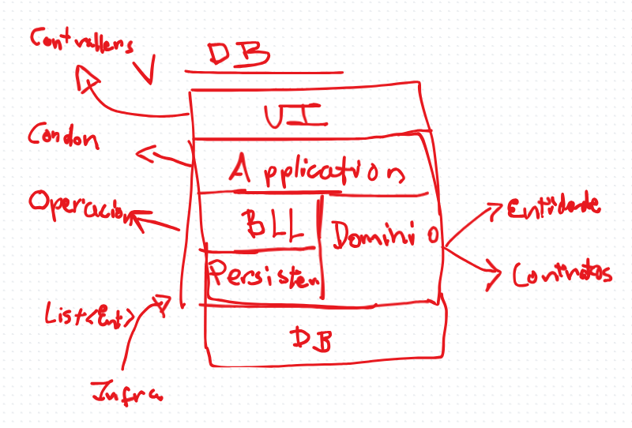
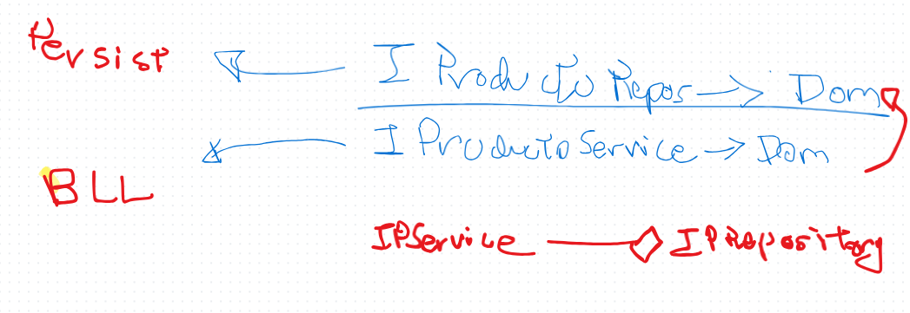
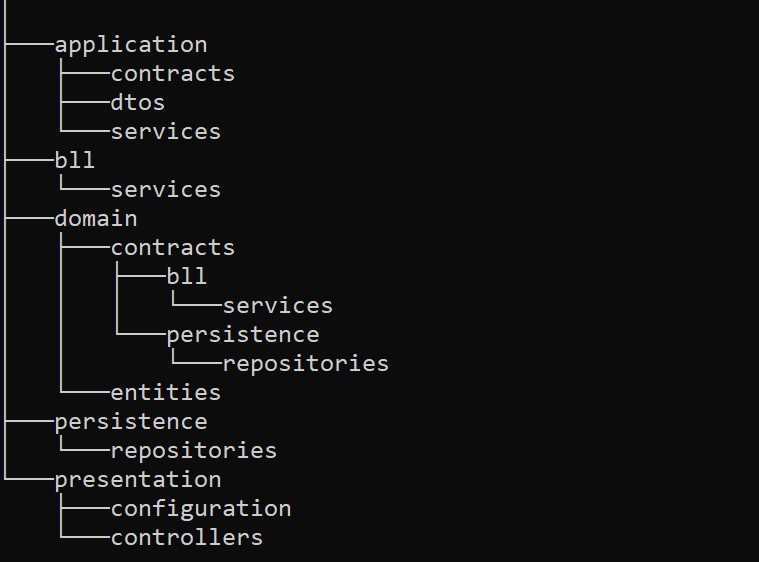

# Arquitectura Jenga (o Torre)

### Propuesta de Arquitectura de software orientada a la simpleza y escalabilidad horizontal

****
**Investigadores:**
- Sebastian Rengel
- Freddy Espinosa

La arquitectura Torre, esta especialmente inspirada en la arquitecutera
por capas, incorporando elementos y conceptos de la arquitectura cebolla.
Se compone de 5 capas en 3 niveles:
### Nivel 1: Capa de presentación/UI
Esta capa corresponde a la interfaz con la que el usuario del sistema
interactúa, en el caso de una API Rest, esta capa corresponde a la capa de controladores, que se encargan de recibir las
peticiones del usuario y enviar las respuestas correspondientes.
### Nivel 2: Capa de aplicacion:
Esta capa corresponde a la capa de servicios que son invocados
directamente por los controladores, son esencialemente 
un conjunto de modulos en los que se maneja logica de negocio intermedia,
validaciones, mapeo de datos, etc. Esta capa es la que se encarga de orquestar 
la logica de negocio entre el usuario y la capas más bajas
### Nivel 3: Capas de BLL-Persistencia y Dominio
#### Capa de Dominio: 
Esta capa contiene 2 componentes principales del sistema: Definiciones
de Entidades y definiciones de Contratos (interfaces) que seran implementados
por las capas de Persistencia y BLL. Esta capa es la base del sistema,
idealmente no debería tener dependencias externas.
#### Capa de Persistencia:
Esta capa implementa los contratos de dominio en todo lo que refiere
a obtención y operaciones transaccionales con datos. Sea a traves
de una base de datos, API externa o cualquier otro mecanismo. 
Se encarga unicamente de operaciones atómicas de persistencia,
no debería tener logica de negocio compleja.
#### Capa de BLL: 
Esta capa implementa los contratos de dominio en todo lo que refiere
a lógica de negocio, validaciones y reglas de negocio puro.
usualmente, los componentes de esta capa tendrán una relacion de composición
con los contratos de persistencia, para poder realizar operaciones
de negocio sin necesidad de saber como se persisten los datos.

## Comparativa entre BLL y Persistence

Aunque ambas capas se centran en implementar los contratos 
de dominio, la diferencia principal radica en que
es esta arquitectura, una depende de la otra indirectamente.
BLL depende de la capa de persistencia para la obtencion de datos
y consolidacion de operaciones de negocio, mientras que la capa de persistencia
no depende de la capa de BLL, ya que su unica responsabilidad es la persistencia
de datos, sin involucrarse en la logica de negocio. Esta separacion permite
que la logica de negocio pueda evolucionar y escalar sin afectar la capa de persistencia

## SHARED o Shared Kernel en la arquitectura Torre
En la arquitectura Torre, tener un Shared Kernel es una practica
viable pero innecesaria, ya que a criterio del autor,
tener un Shared Kernel genera acoplamiento eventualmente, por tanto
al igual que en la arquitectura cebolla, se recomienda evitar esta
practica a menos que sea estrictamente necesario.

### Ventajas de la arquitectura Torre
- Escalabilidad horizontal: La arquitectura Torre permite escalar horizontalmente
cada capa sin extender demasiado la complejidad de la arquitectura final
- Simplicidad, es una arquitectura simplona pero efectiva (es chiquita, pero te duele)
- Nucleo independiente, al igual que en la arquitectura cebolla

### Desventajas de la arquitectura Torre
- Boilerplate, al tener 5 capas, se requiere un esfuerzo adicional para 
implementar, especialmente en proyectos pequeños y de corto plazo
- Escalabilidad vertical limitada, al tener 5 capas, la escalabilidad vertical es limitada,
ya que cada capa tiene una responsabilidad específica y no se pueden mezclar responsabilidades entre capas.

### Como respeta la arquitectura Torre los principios SOLID
- **Principio de responsabilidad única**: Cada capa tiene una responsabilidad específica y no se mezclan responsabilidades entre capas.
- **Principio de abierto/cerrado**: Los componentes de cada capa pueden ser extendidos como en
cualquier otra arquitectura del estilo Dominio-Centrico
- **Principio de sustitución de Liskov**: Los componentes de cada capa pueden ser sustituidos 
por otros componentes que implementen la misma interfaz, sin afectar el comportamiento del sistema.
- **Principio de segregación de interfaces**: Cada capa tiene sus propias interfaces y no se mezclan interfaces entre capas.
- **Principio de inversión de dependencias**: Cada capa depende de las interfaces de las capas inferiores, y no de las implementaciones concretas,
lo que permite una mayor flexibilidad

## Estructura de carpetas

Esta es la estructura de carpetas recomendada para
un proyecto con la arquitectura Torre.
1. **Capa de presentación/UI**: Contiene los controladores, rutas, Configuracion, Middlewares, etc
2. **Capa de aplicacion**: Contiene los servicios, DTOs, mapeadores, etc
3. **Capa de Dominio**: Contiene Entidades y Contracts (separados por bll y persistence)
4. **Capa de Persistencia**: Contiene los repositorios
5. **Capa de BLL**: Contiene los servicios de negocio, validaciones inter-dominio, etc